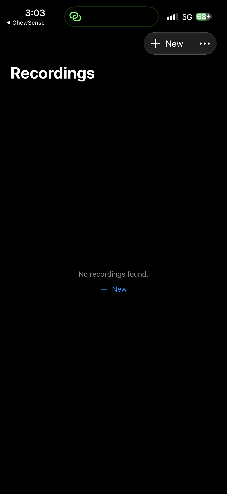

# ChewSense Collect

<!-- WORKSPACE-VERIFICATION:START -->
## Current state and getting started

Updated 2026-10-05. Component of **Chew Sense**. Collect records paired front-camera video and AirPods motion for canonical ChewSense session bundles.

### Startup state

| App | Platform | Result |
|---|---|---|
| Chew Sense Collect and Label | ios | opened |

These are startup observations; simulated flows and production acceptance remain unverified.

### Install and start

#### Chew Sense Collect and Label — ios

Purpose: Collect records paired front-camera video and AirPods motion for canonical ChewSense session bundles.

Requirements: Xcode and the deployment version declared in the Xcode target. Physical Apple devices need Developer Mode, trust/pairing, a signing team and the required capabilities.

Open the project:

```sh
open ChewSenseCollect.xcodeproj
```

Select scheme **ChewSenseCollect**, choose the connected iPhone/iPad, and choose Product → Run. Xcode builds, installs and opens the app; a successful device installation remains available for later testing.

### Chew Sense Collect and Label / ios screenshot



### Next steps

See [the parent project README](<../../../README.md>) for canonical Better Workspace task IDs and the matched Notion row.

- **Chew Sense Collect and Label / ios:** Turn this candidate into a fixture-backed simulated flow with explicit assertions and capture its result.

Detailed continuation: [next steps](<docs/NEXT_STEPS.md>). No archive or release operation was performed.
<!-- WORKSPACE-VERIFICATION:END -->

Collect records paired front-camera video and AirPods motion for canonical
ChewSense session bundles.

Each new session contains:

- `session.json` with shared-host-clock synchronization;
- video and motion CSV media references;
- frame rate, sensor rate, duration, app version, wearer, activity, and
  recording quality;
- `annotations/coarse_labels.json` after coarse chewing/not-chewing review.

Both AVFoundation and headphone motion use the same host-clock origin. New
sessions do not infer alignment from the first motion row.

Collect owns capture and coarse intervals only. Automatic mouth telemetry,
individual chew cycles, food-entry candidates, and final verification belong
to Vision and ChewSenseReview.

See [`../../docs/DATA_CONTRACT.md`](../../docs/DATA_CONTRACT.md).
