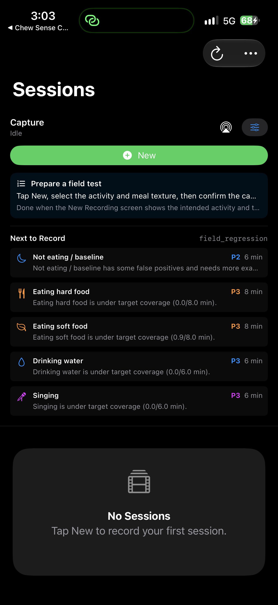

# ChewSense Live

<!-- WORKSPACE-VERIFICATION:START -->
## Current state and getting started

Updated 2026-10-05. Component of **Chew Sense**. ChewSenseLive is the motion-only field-test app. It consumes the promoted CoreML model bundled with this app version, records the active model ID, and exports field-test bundles for later Vision and Review processing.

### Startup state

| App | Platform | Result |
|---|---|---|
| ChewSenseLive | ios | opened |
| ChewSenseLive | mac | build_failed |

These are startup observations; simulated flows and production acceptance remain unverified.

### Install and start

#### ChewSenseLive — ios

Purpose: ChewSenseLive is the motion-only field-test app. It consumes the promoted CoreML model bundled with this app version, records the active model ID, and exports field-test bundles for later Vision and Review processing.

Requirements: Xcode and the deployment version declared in the Xcode target. Physical Apple devices need Developer Mode, trust/pairing, a signing team and the required capabilities.

Open the project:

```sh
open ChewSenseLive.xcodeproj
```

Select scheme **ChewSenseLive**, choose the connected iPhone/iPad, and choose Product → Run. Xcode builds, installs and opens the app; a successful device installation remains available for later testing.

#### ChewSenseLive — mac

Purpose: ChewSenseLive is the motion-only field-test app. It consumes the promoted CoreML model bundled with this app version, records the active model ID, and exports field-test bundles for later Vision and Review processing.

Requirements: Xcode and the deployment version declared in the Xcode target. Physical Apple devices need Developer Mode, trust/pairing, a signing team and the required capabilities.

Open the project:

```sh
open ChewSenseLive.xcodeproj
```

Select scheme **ChewSenseLive**, choose My Mac, and choose Product → Run. Xcode builds, installs and opens the app; a successful device installation remains available for later testing.

### ChewSenseLive / ios screenshot



### Next steps

See [the parent project README](<../../../README.md>) for canonical Better Workspace task IDs and the matched Notion row.

- **ChewSenseLive / ios:** Turn this candidate into a fixture-backed simulated flow with explicit assertions and capture its result.
- **ChewSenseLive / mac:** Resolve the recorded startup blocker and rerun the exact launch command before automating the candidate flow.

Detailed continuation: [next steps](<docs/NEXT_STEPS.md>). No archive or release operation was performed.
<!-- WORKSPACE-VERIFICATION:END -->

ChewSenseLive is the motion-only field-test app. It consumes the promoted
CoreML model bundled with this app version, records the active model ID, and
exports field-test bundles for later Vision and Review processing.

Open `ChewSenseLive.xcodeproj` and run the `ChewSenseLive` scheme.

Live does not own labeling or ground-truth creation. Legacy review readers
remain only for migration and are not reachable from active navigation.

Deploy a passing registry model with:

```bash
chewsense-motion deploy
```

See [`../../docs/RUNBOOK.md`](../../docs/RUNBOOK.md).
