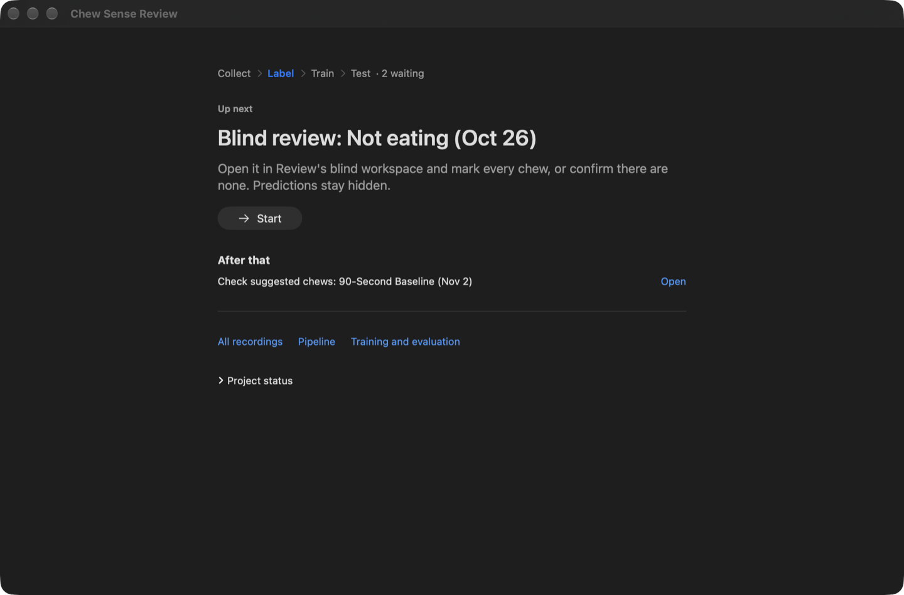
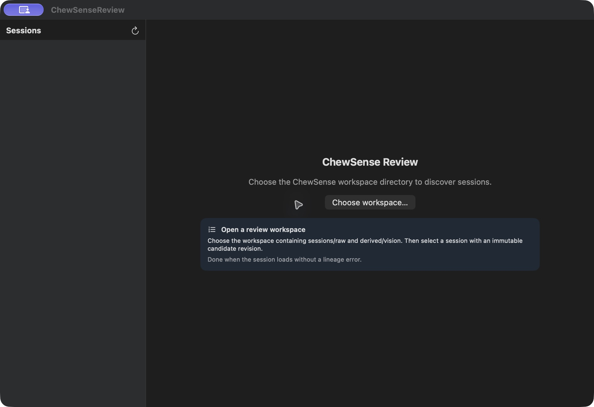

# ChewSense Review

## Guided review — November 9, 2026

Review now opens on **Up next**: the one review task that needs you (from the
loop service's shared status), what it involves, and **Start**. Tasks you
finish disappear at once; the rest are listed under "After that". All
recordings, Pipeline, Training and the full project status stay one click away.

Inside a recording, the header shows its steps and a panel on the right walks
through the current one:

| Task | Steps |
| --- | --- |
| Suggestions shown (assisted) | **Check suggestions** (one looped chew at a time: Yes / Not a chew / Can't tell, optional *Fix the timing*) → **Watch and finish** (play the whole recording, add missed chews, Finish review) → optional **Chewing spans** |
| Blind | **Mark chews** (suggestions hidden; none is a valid answer) → **Finish** |

The step follows the saved draft, so a review resumes at the first undecided
suggestion. Decisions save automatically (about 1.5 s after a change, on Up next,
when switching recordings and on quit); only **Finish review** sets the
verified/full-pass flags, behind the same one-sentence confirmation as before.
Blocked states say why and what to do (undecided suggestions, required
chewing spans, mismatched files: nothing is saved and details are under
*Technical details*). Sections, unclear ranges, timing nods and the labelling
timer are under **More options**; signal charts, annotated video and rotation
are in the header's ⋯ menu. ⌘0 returns to Up next, ⌘1 shows all recordings.



Offscreen renders from `ReviewSnapshotTests.testRenderGuidedReview` (real
workspace, read-only; the video is black in renders):
[check suggestions](../../docs/images/review-guided-check-suggestions.png),
[blind marking](../../docs/images/review-guided-blind-mark.png).

## Section-based review — November 2, 2026

The video has a dedicated unobstructed area. **Sections** reuses the chewing
intervals labeled in Collect; clicking one seeks to its start, zooms the timeline
and focuses the chew queue. **Phone labels**, **Requested actions**, and
**Chewing sections only** control navigation/bands. Requested activity times
come from the recording's actual host-clock events, never the nominal schedule,
and never become verified labels. Independent benchmarks keep predictions
hidden and requested-action navigation off by default. The action toggle can
still be enabled explicitly for navigation; it never creates or verifies events.

The timeline starts in **Scrub** mode: clicking/dragging only moves playback.
Choose **Edit chews** to select, adjust or draw events. **Add chew** is explicit,
and **Delete selected** / **Undo** are always visible. Accidental manual additions
can be removed without changing other annotations.

Use **← / →** or the frame buttons next to Play to pause and step through
individual video frames. **Shift + ← / →** skips a quarter second. The selected
chew's loop affects playback only. Frame stepping updates the same video
surface at its existing size. For a new cycle, pause at the widest opening
and press **A** or **Add chew**, then adjust its start and end markers. Use the
rate menu for slower playback.

In assisted review, **Accept proposals I reviewed here** accepts only pending
proposals in the selected section; other events remain pending and the whole
group can be undone. Phone labels need not be recreated. Fine anchors are for
independent benchmark calibration and corrections, not manually entering every
routine recording's chews from scratch. Final verification still requires the
existing checks. Signal charts are available under **More**.

In **Chewing spans**, use **Play clip** and choose **Chewing**, **No chewing**,
or **Can't tell**. Each choice advances to the next flagged clip. Then check
the suggestions together or one at a time and choose **Save labels**.
**All clips and evidence** lets you revisit clips and adjust boundaries.
Timing starts when you play a clip and pauses on save, panel close, or app
switch. Use **Pause timing** for breaks.

**More → Rotate video right/left** fixes the display of older sideways clips.
It does not edit source video, annotations or clock mapping. Current Collect
captures orientation correctly; physical landscape preview/playback was checked.
See [the physical test record](../../docs/DEVICE_LOOP_2026-11-02.md).

<!-- WORKSPACE-VERIFICATION:START -->
## Current state and getting started

Updated 2026-10-05. Component of **Chew Sense**. ChewSenseReview is the sole authoritative human-review surface.

### Startup state

| App | Platform | Result |
|---|---|---|
| ChewSenseReview | mac | opened |

These are startup observations; simulated flows and production acceptance remain unverified.

### Install and start

#### ChewSenseReview — mac

Purpose: ChewSenseReview is the sole authoritative human-review surface.

Requirements: Xcode and the deployment version declared in the Xcode target. Physical Apple devices need Developer Mode, trust/pairing, a signing team and the required capabilities.

Open the project:

```sh
open ChewSenseReview.xcodeproj
```

Select scheme **ChewSenseReview**, choose My Mac, and choose Product → Run. Xcode builds, installs and opens the app; a successful device installation remains available for later testing.

Retained local audit build: [open the saved application bundle](</Users/zacharysturman/Library/Logs/BetterWorkspace/AppLaunchAudit/2026-10-05/derived/15e02c3a5bc5/Build/Products/Debug/ChewSenseReview.app>). Rebuild from Xcode for distributable signing.

### ChewSenseReview / mac screenshot



### Next steps

See [the parent project README](<../../../README.md>) for canonical Better Workspace task IDs and the matched Notion row.

- **ChewSenseReview / mac:** Turn this candidate into a fixture-backed simulated flow with explicit assertions and capture its result.

Detailed continuation: [next steps](<docs/NEXT_STEPS.md>). No archive or release operation was performed.
<!-- WORKSPACE-VERIFICATION:END -->

ChewSenseReview is the sole authoritative human-review surface.

For every proposed chew it loops a closed-to-open-to-closed clip with at least
five frames of context. Reviewers can accept, reject, edit boundaries, add
missed chews, review food-entry events with wider context, and perform a
final full-video pass.

A session can be verified only after every proposed chew and food entry has been
assessed and the full-video pass is acknowledged.

Review opens exactly one immutable `candidates-vNNNN.json`. Its Python-compatible
`content_sha256` must match both the file contents and `review-draft.json` before
the app will save or mark the review complete. A missing/stale artifact is an
error; the app never substitutes another revision or trims overlapping cycles.

The cycle chart overlays the visual jaw-open signal with synchronized AirPods
acceleration and rotation evidence when `session.json` provides the video-clock
origin. Motion is reviewer context only and never becomes independently edited
truth.

## Build

Open `ChewSenseReview.xcodeproj` in Xcode and run the `ChewSenseReview`
scheme.

The shared scheme includes `ChewSenseReviewTests`:

```sh
xcodebuild -project ChewSenseReview.xcodeproj \
  -scheme ChewSenseReview -destination 'platform=macOS' \
  CODE_SIGNING_ALLOWED=NO test
```

## Main Controls

| Key | Action |
| --- | --- |
| Space | Play or pause |
| A | Add chew at playhead |
| B | Add food-entry event at playhead |
| Delete | Reject selected chew or food entry |
| N / P | Next or previous chew |
| 1 / 2 / 3 | Set Closed start, Maximum open, or Closed end |
| Arrow keys | Frame navigation and marker nudging |
| Command-S | Save the working decision draft |

Saving writes only `session/annotations/review-draft.json`. Final canonical
materialization and immutable review revisions are performed by
`chewsense-vision finalize-session`.

See [`../../docs/RUNBOOK.md`](../../docs/RUNBOOK.md).


## Phase 0 experiment controls

See [the full recording/review protocol](../../docs/PHASE0.md). The HUD Experiment
panel records active labeling time, free uncertain/unobservable time ranges and
explicit marker synchronization confirmation. Unconfirmed clocks leave motion
supervision masked during finalization. The signal chart also follows the
playhead when no chew is selected.

Independent gold uses `prepare-experiment --blind` in a separate workspace with
empty immutable proposals. Model and motion evidence remain hidden there;
annotate manually before opening assisted predictions. Never run Vision in the
blind workspace or evaluate a model against its accepted corrections.

## Pipeline window

**Window → Pipeline** (⌘⇧P) shows the guided loop service: processing state
with Pause/Resume/Stop, pairing codes, sessions requiring review (blind first)
with highlighted spans that open the right workspace at that time, required
recordings, independent evaluation results, weaknesses and training gates.
Choose the `workspace/loop` folder once. See [GUIDED_LOOP.md](../../docs/GUIDED_LOOP.md).
