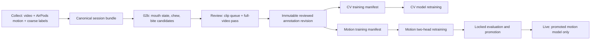

# ChewSense Architecture

ChewSense is one pipeline with three products and one authoritative annotation
contract.

| Product | Path | Owns |
| --- | --- | --- |
| Collect | `01-DataCollection/ChewSense-DataCollection/` | Paired video and AirPods motion capture, metadata, synchronization, and coarse chewing intervals |
| Review | `04-RealWorldTesting/ChewSense-CycleReviewer/` | Human verification and correction of mouth states, chew cycles, bite events, and the final full-video pass |
| Live | `04-RealWorldTesting/ChewSense-RealTime/` | Motion-only field testing with a promoted model |

`02b-VideoAssistedLabeling/` is the sole computer-vision labeling pipeline.
`02-DataPipeline/` owns motion dataset construction, training, evaluation,
registry, promotion, and CoreML deployment.

## Event Definitions

- `mouth_state`: `closed`, `opening`, `open`, `closing`, or `unknown`.
- `chew_cycle`: one closed-to-open-to-closed cycle with start, peak, end,
  confidence, review decision, and optional bout link.
- `bite_event`: the point in time when food enters the mouth.
- `chewing_bout`: an interval following a bite that links associated chews and
  bite events.

A bite event is not a chew cycle and is not a chewing bout.

## Ownership Rules

- Video predictions are retained separately from human review.
- Review creates immutable revisions. It never overwrites the automatic event
  file.
- Only verified sessions with an acknowledged full-video pass are admitted to
  training by default.
- Training manifests reference one recording; they do not duplicate media.
- Dataset hashes include reviewed annotation content, annotation revision, and
  model IDs.
- The session being reviewed and all locked evaluation sessions are excluded
  from recalibration and training.
- Live records the active model ID but does not create ground truth.

## Retired Paths

The stroke seeder, visual labeler, old bite segmentation, and Live review code
remain only for migration and fixture parity. They are not production entry
points. Archive them after unique annotations and tests have been moved to the
canonical bundle.

## Source-Control Boundary

The parent repository currently tracks Collect and Live as gitlinks but has no
valid `.gitmodules` file. Both nested repositories also contain uncommitted
work. Converting them to ordinary monorepo directories now would risk losing
history or local changes.

The safe final absorption sequence is:

1. Commit or export every nested worktree change.
2. Record each nested repository's remote and current commit.
3. Import history with `git subtree` or a history-preserving filter.
4. Replace each `160000` gitlink with normal tracked files.
5. Verify builds and data paths before deleting nested `.git` directories.

Until that checkpoint is made, the runtime architecture is consolidated but
the two source-control boundaries remain intentionally untouched.
