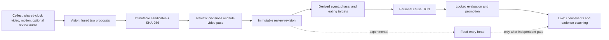

# Architecture

ChewSense has three role-based apps, one immutable annotation lineage, and two
model pipelines.



## Communication between apps

Phones are offline-first and reach the Mac by identity (pinned certificate)
over whichever route it reports that answers (same Wi-Fi or hotspot today;
the tailnet route waits on an ATS decision). They never use a typed address. The Mac's `workspace/loop/` is the single source of truth. All
phone ↔ Mac networking is `apps/shared-capture/LoopLink.swift`. Rules and the
decision record: [COMMUNICATION.md](COMMUNICATION.md).

## Ownership

| Component | Owns | Does not own |
| --- | --- | --- |
| Collect | Capture, clock origin, interruptions/gaps, coarse labels | Individual-chew truth |
| Vision | Fused jaw signal, automatic chew and food-entry proposals | Human decisions |
| Review | Candidate-bound decisions, uncertainty, completion | Detector repair or model training |
| Motion | Derived targets, causal model, replay, evaluation, registry | Video truth |
| Live | Promoted-model inference, raw-output logs, honest coaching | Ground truth or implicit bites |

Collect and Live evaluation capture both compile the shared schema writer in
`apps/shared-capture/CanonicalCaptureContract.swift`. Recording controllers
remain app-specific, while the manifest, host-clock, gap/interruption, media
hash, and atomic JSON rules have one Swift implementation.

## Vision Proposal Path

The proposal generator uses calibrated jaw opening: blendshape first, lip
aperture next, and chin movement as a fallback. A cycle is constructed between
successive closed minima with one maximum-open anchor between them. Candidate
normalization and IDs happen once before any reviewer or motion alignment.
The older parallel `chews`/`mouth_cycles` truth paths are not canonical.

## Motion Model Contract

The implemented personalized-v2 architecture/runtime contract is a small
causal temporal convolutional network; no real personalized checkpoint has
passed promotion yet.
Each inference consumes three seconds of six-axis IMU resampled to 50 Hz plus
a gap-validity channel. It evaluates every 100 ms and emits:

```text
eating_logit
chew_event_logit
phase_sin
phase_cos
phase_confidence
```

Chew events come from eating-gated local maxima of the event head with a
250 ms refractory period. Phase is auxiliary evidence, never a zero-crossing
counter. Python replay and Live retain raw model rows and decoded event times
for parity checks.

## Coaching Contract

The wearer selects `soft`, `mixed`, `hard`, or `unknown` before a meal.
Cadence baselines become available after three verified calibration meals for
that texture. “Too fast” uses the median of five confident inter-chew
intervals, requires three sustained violations, and observes a 20-second cue
cooldown. Unknown texture still permits cadence summaries but disables
chew-count goals.

Food entry is a planned longer-context experimental head. Its independent
promotion-policy scaffold exists, but the current five-output TCN and Live
runtime do not implement that head. Until it exists and passes, Live hides
bite and chews-per-bite metrics and never produces “not enough chews”
feedback.

## Source And Local Data

Active source lives under `apps/`, `pipelines/`, `tools/`, `fixtures/`, and
`docs/`. Local recordings and generated artifacts live under `workspace/`.
Recoverable retired material lives under ignored `archive/`; see
[LOCAL_DATA_RECOVERY.md](LOCAL_DATA_RECOVERY.md).
