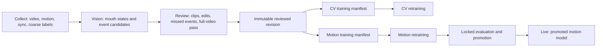

# Architecture

ChewSense has three products, two active pipelines, and one canonical session
bundle.



## Ownership

| Component | Owns | Does Not Own |
| --- | --- | --- |
| Collect | Capture, shared-clock timing, recording metadata, coarse labels | Individual chew truth |
| Vision | Mouth states and automatic chew/bite candidates | Human decisions |
| Review | Human corrections and completion gating | Model training |
| Motion | Row labels, training, evaluation, registry, promotion, deployment | Video labeling |
| Live | Versioned motion inference and field-test export | Review or ground truth |

## Source Layout

```text
apps/collect-ios
apps/review-macos
apps/live-ios
pipelines/vision
pipelines/motion
tools/evaluation
fixtures
docs
archive
```

## Local Data Layout

`CHEWSENSE_WORKSPACE` defaults to `<repo>/workspace`.

```text
workspace/
  sessions/{raw,field-tests,curated,rejected}
  derived/{vision,motion}
  models/{registry,exports}
  manifests
  reports
  archive-assets
```

## Event Semantics

- `mouth_state`: closed, opening, open, closing, or unknown.
- `chew_cycle`: one closed-to-open-to-closed cycle with start, peak, and end.
- `bite_event`: food-entry timestamp.
- `chewing_bout`: interval following a bite and linking associated chews.

A bite event is not a chewing bout.

## Invariants

- Automatic predictions remain separate from human revisions.
- Human revisions are immutable.
- Unverified sessions are excluded from training by default.
- Dataset hashes include annotation revision and model versions.
- Locked test sessions and the session under review are never recalibrated.
- Live uses only versioned promoted models.
- Archived code is not imported by active CLIs or normal tests.
