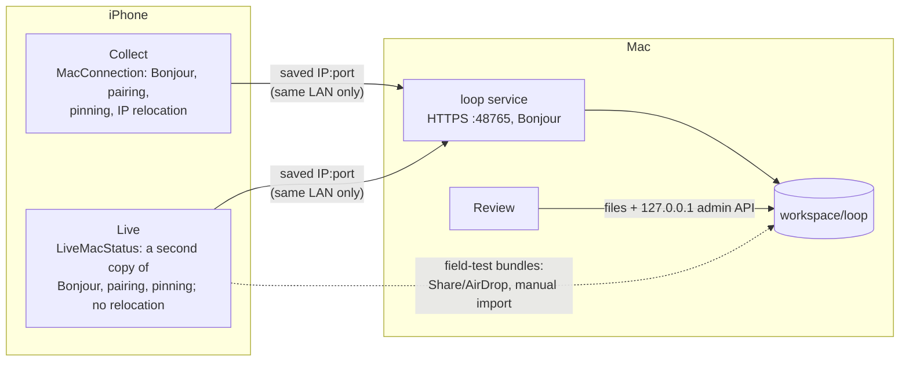
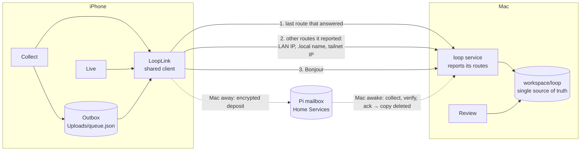

# How the Chew Sense apps communicate

Decided November 9, 2026 after an audit of every app, service and data path.
This is the intended model. Read it before changing anything that moves data
between the iPhone and the Mac.

## The model in one paragraph

The iPhone is offline-first: a recording is complete and safe the moment it is
saved on the phone, and nothing about recording depends on the Mac. The Mac is
an **optional worker** that owns all processing, labelling and training. Phones
reach it **by identity** (its pinned certificate), over whichever route the Mac
reported that answers now: the same Wi-Fi or the iPhone's hotspot, even after
the Mac's address changes. They never use a typed address. **When the Mac
doesn't answer**, Collect deposits the recording, encrypted on the phone, in
the Home Services **mailbox** on the Pi. The Mac collects it when it wakes,
and the Pi then deletes its copy. When neither answers, the recording waits on
the phone and is retried automatically. Every app reads one source of truth,
the Mac's `workspace/loop/`. The phone keeps only its own outbox.

## Rules for future changes

1. **Recording must never wait for the Mac.** No capture, save or coarse-label
   step may require a connection.
2. **No addresses in normal use.** Do not add UI that asks for an IP address or
   shows one outside a "Details" disclosure. Do not store a single address as
   *the* way to reach the Mac. Add a route kind to `routes.py` and
   `LoopRoute.Kind` instead.
3. **One client.** All phone ↔ Mac networking goes through
   `apps/shared-capture/LoopLink.swift`. Do not write another `URLSession`,
   `NWBrowser` or pairing flow in an app.
4. **The Mac being away is not an error.** Connectivity failures never count
   toward an upload's failure limit (`LoopLink.isUnreachable`). Only a
   rejection by the Mac does.
5. **One source of truth per fact** (table below). Phones cache, label the
   cache as such, and never decide processing, review or training state.
6. **Recordings cross cellular only to a Mac on the same local network**
   (`LoopNetwork.allowsRecordingTransfer`). Status and catalog are small and
   may use any route.
7. **No new place for video without the wearer's approval.** The Pi mailbox
   was approved (Nov 9) for phone-encrypted, temporary deposits only. CloudKit
   and iCloud Drive were not. No ATS exceptions without approval
   either. See *iOS refuses the tailnet route* and *Pi mailbox* below.

## Before: what the audit found



Problems, in the order they hurt:

| Problem | Effect |
| --- | --- |
| The pairing stored one IP address, discovered by Bonjour on the same network | Any network change (another Wi-Fi, the iPhone's Personal Hotspot) made the Mac "unreachable". The Nov 9 patch re-searched only the same network, and only in Collect |
| Two copies of discovery, pairing and pinning (Collect and Live) | Fixes reached one app only. Live timed out on the hotspot while Collect had been fixed |
| Connectivity failures counted toward an upload's 5-attempt limit | A Mac that slept mid-transfer a few times turned a recording into **Upload failed**, needing a manual retry |
| "Send automatically" was off by default; sending ran only while Collect was on screen | Recordings sat on the phone until someone remembered |
| Queue work ran while a new recording was being made | Each 60-second sync during a take could count a failed attempt ("Stop and finish the recording before export") |
| Technical detail in normal UI (addresses, certificate, "enter new address") | The wearer had to understand networking to fix ordinary situations |

What was already right and is kept: resumable, SHA-256-verified uploads;
idempotent imports (a re-sent recording is recognized, a changed one is
quarantined, never overwritten); certificate pinning with an HMAC-bound pairing
code; crash recovery of the Mac's job queue; Review reading the workspace
directly; one shared project status (`project_status.py`).

## After: the model in place



* **Identity, not address.** After pairing, the Mac sends paired phones its
  routes (`pipelines/vision/chewsense/loop/routes.py`): the address on its
  current network, its `.local` name, and its tailnet MagicDNS name (stable on
  every network while Tailscale runs on both devices). `LoopLink` remembers them,
  tries the last working one, and when it stops answering, probes the others
  together (5 s) and then Bonjour. It switches only when the pinned
  certificate and the device token are accepted. Routes are sent only to
  paired devices, never from `/v1/hello`.
* **Outbox.** `UploadManager` is on by default. It runs after each recording,
  when the app opens, every minute while it is open, when the phone joins a
  network, briefly after the app is closed (`BackgroundAssertion`), and from a
  background processing task (`com.chewsense.collect.sync`) that iOS
  schedules, often while charging. Waiting items read "Saved on this iPhone. It
  will go to your Mac automatically…". The upload ID and offset are kept, so
  transfers resume where they stopped.
* **One client.** Collect's `MacConnection` and Live's `LiveMacStatus` are thin
  wrappers over `LoopLink`. Pairing UI is the shared `LoopPairingForm`, and
  technical detail is the shared `LoopConnectionDetails` (under **Details**).
* **No change** to the transfer protocol, import rules, Review, the shared
  status or the locked evaluation split.

## Who owns which fact

| Fact | Source of truth | Readers |
| --- | --- | --- |
| A recording exists and is complete | Phone (`Documents/<session>`) until imported; then the Mac's read-only `loop/sources/<id>` plus its receipt | Collect list |
| Waiting to send / sending | Phone outbox (`Uploads/queue.json`) | Collect |
| Received and verified | Mac (`loop/uploads/*/meta.json`, receipt) | Collect via `/v1/sessions/<id>/status` |
| Processed / needs attention | Mac job queue (`loop/jobs`) | Collect, Review (Pipeline) |
| Review drafts, verified labels | Mac annotation lineage (`loop/assisted`, `loop/blind`, immutable revisions) | Review, Motion |
| Coarse labels from the phone | In the recording bundle, sent once. A later edit arrives as a new archive and is **quarantined**, never merged over verified work | Mac importer |
| Ready for training, test split, retired takes | Mac (`experiments/eating/splits.json`, `loop/state/retired`) | Motion, Review |
| "Where we are" | `project_status.py` → `/v1/status` and `project_status.json` | Collect, Live (cached when offline), Review |
| Experiment catalog | Mac `experiments/catalog.json` | Collect (cached) |

## Which operations need the Mac, and how

| Operation | Kind | Needs the Mac? | How now |
| --- | --- | --- | --- |
| Record, save, coarse-label | Local | No | Phone only |
| Send recording (50–360 MB so far) | Large file, eventual | When it runs | Outbox → any answering route. Resumes, never imported twice, waits instead of failing |
| Received / processed status | Small metadata, eventual | Yes (owner) | Polled while the app is open; cached |
| Vision, proposals, review tasks | Background processing | Yes (MediaPipe in an offline sandbox, Python) | Mac worker; restarts resume queued jobs |
| Blind / assisted review, verification | Interactive, Mac-only | Yes | Review on the Mac, local files |
| Training, evaluation, export | Heavy, eventual | Yes | `chewsense-motion` on the Mac |
| Shared status card | Small, eventual | No (cached) | Phones show the last message, labelled stale |
| Live model checks | Real time, on-device | No | Live on the phone (bundled model) |
| Pairing | Once per app | Yes, once | Six-digit code shown in Review |

Nothing needs real-time phone ↔ Mac communication. Everything that crosses
devices is eventual, which is why an outbox fits better than a live link.

## Alternatives considered

| Option | Verdict | Why |
| --- | --- | --- |
| Keep the IP pairing and patch relocation | Rejected | Patched one symptom in one app; still same-network only |
| **Reach the Mac by identity over its reported routes (chosen)** | Adopted (LAN, hotspot, `.local`); tailnet blocked by ATS | All four devices are already on one tailnet and the service already answers there. No new infrastructure, storage or cost. Video still goes only phone → Mac |
| CloudKit private database (recordings as `CKAsset`) | Rejected for recordings | Video and motion would be stored in iCloud (a new place for face video, needs approval) and counted against the wearer's iCloud quota. The Python pipeline cannot read CloudKit natively, so a Mac app would have to mirror it to files anyway. iCloud would duplicate, not replace, the transfer. Metadata-only sync is possible but adds a second source of truth |
| SwiftData (+ CloudKit) as the shared model | Rejected | CloudKit-backed stores cannot enforce unique constraints, and all attributes must be optional or defaulted. The canonical records are immutable, hash-checked files read by Python. A synced store would compete with them. The phone's state is one small queue file |
| iCloud Drive folder | Rejected for now | Simplest file sync, but uploads face video to iCloud (approval), has opportunistic timing and evicts files on the Mac. It also gives no "received and verified" receipt |
| App Groups / shared keychain between Collect and Live | Deferred | Would make one pairing serve both apps. Adopting a shared keychain group changes how both apps find their existing tokens, which risks the current pairings for a one-time convenience |
| MultipeerConnectivity | Rejected | Needs both ends in the foreground and nearby; the Mac side is Python |
| Background `URLSession` for the whole archive | Deferred | Would survive app termination mid-transfer, but needs a streaming upload path on the Mac (the service reads each chunk into memory). The background processing task plus resumable chunks cover the same need more simply |
| **Pi mailbox (Home Services relay)** | Adopted as the fallback (built and tested; deployment waits for approval) | Covers a sleeping Mac and other networks without an ATS change. The Pi holds only ciphertext, and only until the Mac acknowledges. See below |

### iOS refuses the tailnet route (found on the iPhone, Nov 9)

The iPhone reaches the Mac over Tailscale: the Mac's certificate arrives.
iOS App Transport Security then rejects it with `-1200`/`-9802`. ATS exempts
private LAN addresses and `.local` names, but not Tailscale's `100.x`
addresses or `*.ts.net` names. An ATS exception for `ts.net` was blocked
(it weakens TLS policy) and is **not** in the apps. Options, for the wearer to
choose:

1. **Pi mailbox (below, chosen and built).** The Pi already has a valid Tailscale certificate,
   so phone → Pi works from any network with no ATS change. Recommended,
   since it also covers a sleeping Mac.
2. **Tailscale Serve on the Mac** with a Let's Encrypt certificate for its
   `ts.net` name. ATS passes. Pinning would have to accept that certificate
   for that name, and the Mac's name appears in public Certificate
   Transparency logs (the Pi's already does).
3. **ATS exception for `ts.net`** (pin still enforced). Needs explicit
   approval because it relaxes TLS policy.

Until then the tailnet route is tried last and fails in under a second, so
it costs nothing.

### Pi mailbox (deployed Nov 9, Home Services 0.4.9-20261109T142058Z)

This is the answer to both remaining gaps: a sleeping Mac, and reaching home
from another network (the Pi has a public Tailscale certificate, so no ATS
change is needed).

```mermaid
sequenceDiagram
    participant P as Collect (iPhone)
    participant H as Home Services (Pi)
    participant M as Mac loop service
    P->>M: 1. the Mac's routes (fastest; no copy anywhere else)
    alt Mac doesn't answer, and the network isn't cellular or Low Data Mode
        P->>P: seal the ZIP (AES-256-GCM, key from the Mac)
        P->>H: deposit: announce hashes, upload resumably, complete (SHA-256 checked)
        H-->>P: waiting · "Delivered to your home server"
        M->>H: while awake, every 30 s: pending?
        M->>H: download (Range resume), check sealed hash
        M->>M: decrypt, check archive hash, enqueue_archive (same import as direct)
        M->>H: ack imported | duplicate | rejected, only after the import result
        H->>H: delete the copy
        P->>H: deposit collected → "Received by the Mac"
    end
    M->>H: status copy (no routes, tokens or keys)
    P->>H: show it while the Mac sleeps
```

| Part | Where |
| --- | --- |
| Home Services module (contract 1.5) | `chewsense.py`, `/api/v1/chewsense/…`, scopes `chewsense:deposit` (phone, cannot download) and `chewsense:collect` (Mac). Ciphertext only, on the guarded HDD. 4 GB per deposit, 20 GB held, partial deposits abandoned after 7 days. Branch `chewsense-mailbox` in the worktree `~/Workspace/Projects/_worktrees/home-services-chewsense-mailbox` (see its `docs/CHEWSENSE_MAILBOX.md`) |
| Mac collector | `pipelines/vision/chewsense/loop/mailbox.py`, a thread in the loop service. Configured once with `chewsense-vision loop mailbox-configure`. Key `loop/service/mailbox.key` (0600). Always verifies a deposit itself, even when its announced hash is already known |
| Phone | `apps/shared-capture/LoopMailbox.swift` (part of the one client). The address, token and key arrive inside the Mac's pinned `/v1/status`, so there is no setup on the phone. `UploadManager` tries the Mac, then the mailbox, then waits. The ZIP stays until the Mac's receipt; the recording folder is never deleted |

## Privacy and resources

* Video and motion go phone → Mac over TLS pinned to the Mac's certificate.
  When the mailbox is used, they cross the Pi only as AES-256-GCM ciphertext
  whose key the Pi never has, and only until the Mac acknowledges. There is
  no third-party storage and no ATS exception.
* Cellular: a recording is never sent over cellular or Low Data Mode unless
  the Mac is on the same local network (for example joined to the iPhone's
  hotspot, where the transfer stays local).
* Battery: no persistent connection. Probes run only after a failure (at most
  every 30 s); the background task is scheduled only while work is pending.
* Mac: the route check runs `tailscale status --json` at most once a minute.
  When the mailbox is configured, the collector polls it every 30 s while
  awake.
* Pi: at most 20 GB of ciphertext while the Mac is away. iCloud: none.

## Verification

| Scenario | How tested | Result |
| --- | --- | --- |
| Routes only to paired devices; status carries them; cached; broken probes harmless | `pipelines/vision/tests/test_loop.py` | Pass |
| Old pairing records decode; route order; tailnet detection; cellular rule; which errors trigger a search; plain offline wording; auto-send default | `ChewSenseCollectTests/LoopLinkTests` (simulator) | Pass |
| Mac changed address → found on a reported route, no new code | `tools/loop-e2e` (real Collect code ↔ isolated real service, synthetic recordings) | Pass |
| Mac unreachable → recordings stay queued, 0 failed attempts, wording without addresses | `tools/loop-e2e` | Pass |
| Mac back → two queued recordings send, verify, process | `tools/loop-e2e` | Pass |
| Queue lost, recording sent again → recognized as duplicate, no second import, nothing quarantined | `tools/loop-e2e` + harness checks | Pass |
| Interrupted upload resumes from the Mac's offset; corrupted upload restarts | `test_end_to_end_pair_upload_resume_and_process`, `test_checksum_mismatch_restarts_upload` | Pass (Mac side) |
| Mac restarts during processing | `test_pause_stop_resume_and_crash_recovery` | Pass (Mac side) |
| Mailbox scopes (phone can't download), resume, checksum restart, idempotent re-announce, quota, missing disk, deletion after ack, abandoned partials, status copy | Home Services `tests/test_chewsense_mailbox.py` (full suite passes) | Pass |
| Sealed format round trip; tampering, truncation and a foreign key rejected; resumed download; ack only after import; duplicate and rejected acks; no secrets in the status copy | `test_loop_mailbox.py` | Pass |
| **Mac awake:** recording goes direct, never through the Pi | `tools/loop-e2e` (real Collect code, real Mac service, real Home Services module; isolated fixtures, synthetic recordings) | Pass |
| **Mac asleep:** encrypted deposit on the Pi; Pi outage mid-deposit; resumes at the Pi's offset; 0 failed attempts | same | Pass |
| **Neither reachable:** recording waits, 0 failed attempts; deposited when the Pi returns | same | Pass |
| **Mac sleeps mid-transfer:** direct transfer resumes at the Mac's offset, not from zero | same | Pass |
| **Mac wakes:** collects, decrypts, verifies, imports and acknowledges; phone shows processed; no copies left on the Pi; ZIPs removed only after receipt; recordings still on the phone | same | Pass |
| Swift encryption ↔ Python decryption interoperate | same (two recordings imported via the Pi) | Pass |

Physical iPhone 16 Pro Max, Nov 9 2026 (Mac on home Wi-Fi after a morning on
the iPhone's hotspot):

| Scenario | Evidence | Result |
| --- | --- | --- |
| Collect's saved address was the old hotspot IP (`172.20.10.13`); after the service restart, launching Collect found the Mac at `10.0.0.43` by itself and saved all three routes | Collect preferences read back from the device; `devices.json` `last_seen` 12:41:41 | Pass |
| A real recording waiting in Collect's queue updated to "Processed on the Mac" | Phone `Uploads/queue.json` | Pass |
| Live (timed out on the hotspot this morning) fetched the shared status with the new client | `build/Device-Status-Live.xcresult`, headline and summary matched | Pass |
| Pinned answer from the Mac on its LAN address and `.local` name | `build/Device-Routes-Collect.xcresult` | Pass |
| Pinned answer on the tailnet | Same test, earlier run | **Fail: ATS `-9802`** (see above) |
| Mac asleep, iPhone offline, different networks, Personal Hotspot, interrupted transfer on the device, background task | Not run on the device | Not verified (covered only by the simulator and isolated-service tests above) |

Run: `tools/loop-e2e` (end to end, ~2 min after build); Collect
`LoopLinkTests`; Live tests; `pytest pipelines/vision/tests/test_loop*.py`.

### Deployed relay on the physical iPhone, Mac and Pi (Nov 9 2026, home Wi-Fi)

Each test resent a real recording the Mac already held, checked byte for byte
against its import receipt first, so nothing new entered the dataset. "Mac
away" means its loop service was stopped.

| Scenario | Evidence | Result |
| --- | --- | --- |
| Both apps received the home server from the Mac by themselves after launch, and reach the Pi with its public certificate (no ATS exception) | `build/Device-Relay-config.xcresult`, `build/Device-Status-Live.xcresult` | Pass |
| Mac away: 158 MB recording sealed and deposited on the Pi (166 MB ciphertext); cut at 40 MB as if the app closed; a new outbox resumed at the Pi's offset; 0 failed attempts; 60 s, about 3 MB/s | `build/Device-Relay-deposit.xcresult` | Pass |
| Pi held only ciphertext (`CSMB` header, no ZIP, QuickTime or JSON signatures) | inspected on the Pi | Pass |
| Mac woke: collected 51 s later, verified, decrypted, recognized the duplicate, acknowledged; the Pi deleted its copy; source, receipt, archive and provenance unchanged; nothing quarantined | Mac and Pi state compared before and after | Pass |
| Phone saw the receipt (processed) and removed only its temporary copies; the recording stayed | `build/Device-Relay-collect.xcresult` | Pass |
| Mac reachable: 166 MB straight to it, cut at 40 MB, resumed at the Mac's offset, 12.6 s; no deposit on the Pi | `build/Device-Relay-direct.xcresult` | Pass |
| Background retry: an item in the app's own queue deposited while the Mac was away; after the Mac collected it, only the registered background task (launched through the scheduler's development hook) brought it to processed | `build/Device-Relay-background-*.xcresult` | Pass |
| iOS accepts the background task request (identifier and background mode) | `build/Device-Routes-Collect.xcresult` | Pass |
| Switching Wi-Fi, hotspot and cellular; phone offline while recording; iOS choosing when to run the background task | needs hands on the phone, or time | Not run on the device |
