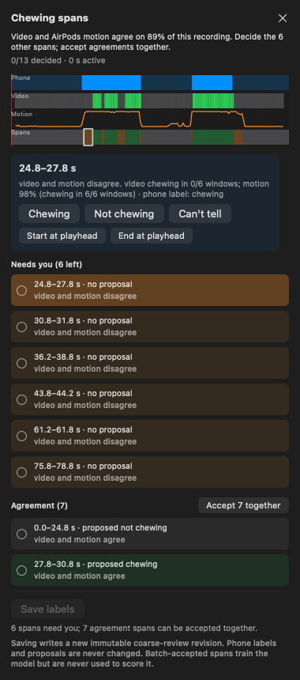
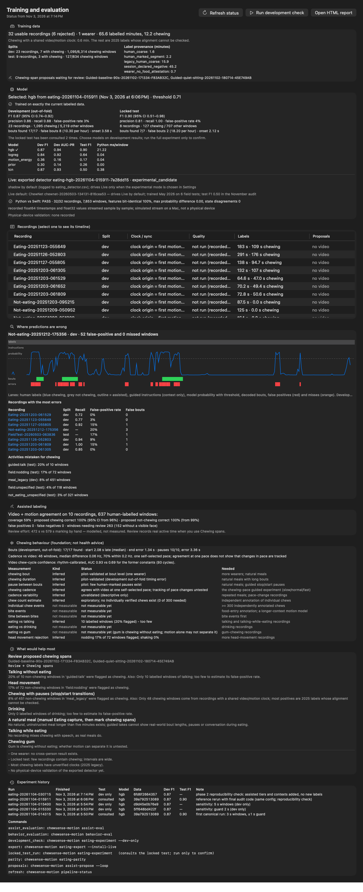

# Phase 2 — assisted labeling, on-device detection and training transparency (November 3, 2026)

Continues [AUDIT_2026-11-03.md](AUDIT_2026-11-03.md) on branch
`claude/phase2-2026-11`. Every number below comes from recordings of **one
wearer**. Synthetic data was used only in software tests. Nothing was
promoted. The loop service was not restarted, and no build was published.

## Summary

| Area | State |
| --- | --- |
| Assisted labeling | Working on the Mac: proposals, Review panel, saved decisions with provenance, dataset tiers, loop step. Real review time not measured yet. |
| On-device detector | The selected gradient-boosting model runs in Live's Swift runtime. It is **bit-identical** to Python on all 32 recordings. Shadow mode by default. No physical-device run yet. |
| Training transparency | `pipeline-status` plus Review's Training and Evaluation window. |
| Behaviour measurements | Registry and validation in place. Bouts and pauses are pilot-validated; cadence agrees with video at one pace; chew counts, bites and drinking/gum separation are not measurable yet. |
| Collection | New guided Natural Meal protocol. Error analysis now separates confound contexts. |

## 1. Assisted labeling

**How it works.** After Vision, each 3 s window is judged twice,
independently:

- **Video:** at least 2 ungated chew-cycle proposals in the window, with the
  face visible.
- **Motion:** exported detector probability ≥ 0.71, the development
  threshold.

Agreement spans are *proposed* as chewing or not chewing. Disagreements,
hidden faces and missing motion become review spans. Spans where both sources
contradict an existing phone label are flagged first.

Proposals are immutable, hashed artifacts:
`<workspace>/derived/assist/<id>/coarse-proposals-vNNNN.json`. The rules
were fixed before measurement: the pilot's video rule and the detector's
development threshold. Nothing was fitted to the evaluated recordings.

**Review → Chewing spans** (`apps/review-macos/.../CoarseAssistPanel.swift`)
offers:

- lanes for phone labels, video, motion and spans;
- one-click accept, chewing, not chewing, or can't tell;
- start and end set at the playhead;
- accept all agreement spans together;
- active-time and action counting.

Saving writes an immutable `annotations/coarse-review-vNNNN.json`. Phone
labels and proposals are never modified. The dataset loader maps decisions to
**training-only** tiers:

- `human_assisted`: decided individually;
- `human_batch_accepted`: accepted in a batch, with automatic boundaries
  trimmed by 0.5 s.

Neither tier ever enters evaluation. An assisted decision that repeats a
phone label keeps the phone label's independent tier.



**Evaluation** (`chewsense-motion assist-eval`) used 10 recordings with
video and human labels, and 637 guard-banded labelled windows. Motion
probabilities are out-of-fold (development) or locked-test predictions, so
no recording is judged by a model trained on it.

| Measure | Result |
| --- | --- |
| Agreement coverage | 59% of labelled windows (95% CI 55–62%). 152 windows had no visible face. |
| Proposed chewing correct | 82/82 (Wilson 95% lower bound 0.955) |
| Proposed not-chewing correct | 292/292 (lower bound 0.987) |
| False positives / false negatives among proposals | 0 / 0 |
| Chewing recovered without review | 65% (82/127). The rest goes to review (crunchy-food video misses). |
| Guided baseline | 89% agreement. 6 review spans, all 0.6–3 s boundary disagreements. |
| Review effort | **Modelled only:** 473 s assisted vs 579 s marking by hand (all 10 recordings); 53 s vs 115 s on the guided baseline. |

This reproduces the pilot's 374/374 and adds the denominator: it is 374 of
637 labelled windows, not of all time. Agreement with no errors on this small
sample is encouraging, not proof. The motion component is the model being
trained, so batch-accepted labels are training-only and the wearer decides
every disagreement.

The modelled saving is small on these recordings because many are field tests
with the face out of view. Real time saving will come from Review's
`review_context.active_seconds` once you use the panel.

**Can video find chewing without a hand-marked span?** Yes. Vision's
`mouth_cycles.json` and per-frame jaw signals already cover the whole
recording; only the reviewable *candidates* were gated. The proposals use the
ungated output.

**Loop integration.** New uploads get proposals automatically after Vision
(`coarse_proposals` step). A failure is recorded on the session and does not
block review.

## 2. On-device motion-only detector

**Selected model:** gradient boosting from run `eating-20261104-015911`. It
had the best development AUC-PR. The threshold (0.71) was chosen on
development data. The decoder is EMA 0.4, hysteresis 0.71/0.51, start after
3 windows and end after 2, at a 0.5 s stride. Nothing was changed for
deployment.

**Approach:** a versioned JSON specification, not Core ML.

- `chewsense-motion eating-export` writes the input contract, the
  numpy-resolved feature constants, 250 trees, the threshold and the decoder.
- `apps/live-ios/ChewSenseLive/EatingDetector/` evaluates it in
  Foundation-only Swift.

Reasons for choosing this over Core ML:

- **Consistency:** Core ML has no histogram-gradient-boosting converter.
  Tree comparisons in float64 reproduce scikit-learn exactly, and the
  specification removes every re-derived constant.
- **Upgrades:** a new model is a data file; the model ID hashes only
  decision content.
- **Cost:** 590 KB, about 0.2 ms per window on a Mac. One window is
  evaluated every 0.5 s.

Model ID: `eating-hgb-20261104-015911-7a28dd15`.

**Parity** (`chewsense-motion eating-parity`). Every recording's exact
float64 timestamps and float32 values are streamed sample by sample through
the Swift runtime, compiled from Live's sources, and compared with the Python
reference:

| Check | Result |
| --- | --- |
| Recordings | 32/32 pass, 7,911 windows (7,853 with enough motion) |
| Window end times, validity, invalid-window handling | identical |
| 80 features | 100% bit-identical |
| Probability | max difference 0.0 |
| Decoder state and bouts | 0 disagreements; bouts identical in all 32 |
| Reference vs experiment | trees reproduce scikit-learn exactly (0.0); saved test predictions to 1e-16 |
| Noise floor | a one-float32-step input change altered 0 of 1,195 probabilities |

One behaviour differs from the experiment's replay. A window with under 90%
measured motion now always feeds probability 0 to the decoder; the experiment
applied that only inside labelled time. This changed 2 windows and 0 decoder
states across all recordings.

**Live.** Added in `MotionManager.swift` and `ConfigurationView.swift`:

- The default mode, **Bundled ChewNet**, keeps ChewNet driving the UI. The
  exported detector runs alongside and is logged to `eating_detector.csv`.
- **Settings → Motion-Only Eating Detector → Exported detector
  (experimental)** lets it drive the chewing state.
- The session metadata records which detector drove Live.

Live's tests (iPhone 17 Pro simulator, iOS 26.5) pass 33/33, including exact
parity on a synthetic stream with gaps and dropped samples. **Not done:** any
run with physical AirPods, on-device latency, or battery measurement.

## 3. Training transparency

`chewsense-motion pipeline-status` reads existing artifacts only and writes
`workspace/experiments/eating/pipeline_status.json`. Review → **Window →
Training and Evaluation** (⇧⌘T, also linked from Pipeline) shows:

- recordings and rejections with reasons;
- clock and sync checks, quality checks, and label provenance;
- split membership and data totals;
- whether the model was trained on exactly the current data (fingerprint);
- selected versus Live models, and parity;
- development and test metrics with intervals;
- per-recording timelines of labels, instructions, probability, bouts and
  errors;
- assisted-labeling accuracy and the behaviour status;
- what to record next, plus the experiment history and commands.

Two buttons run safe commands: **Refresh status** and **Run development
check** (`eating-experiment --dev-only`). Locked-test runs remain a
deliberate command-line action, and the window shows how often the test has
been consulted (2).



## 4. Chewing-behaviour foundation

`pipeline/behavior/`: a registry (`measures.REGISTRY`) states for each
measurement whether it is inferred or not measurable yet, its reference,
status and what is needed. `session_behavior` computes bouts, pauses,
cadence, variability and an *exploratory* chew-count estimate from motion
only.

`chewsense-motion behavior-eval` validates them:

| Measurement | Reference | Result |
| --- | --- | --- |
| Bouts (development, out-of-fold) | human spans | 17/17 found; start a median 2.1 s late, end 1.3 s off, duration 6 s short. The decoder's confirmation lag; not tuned away. |
| Pauses between bouts | human gaps | 10/10 detected; median error 3.4 s |
| Cadence (6 s windows) | video jaw frequency | median difference 0.06 Hz; 70% within 0.2 Hz (46 windows). Range 1.2–1.8 Hz, one self-selected pace (r = 0.15), so tracking pace changes is untested. |
| Cadence confidence | — | motion peak share does **not** predict agreement (67/73/69% by tercile), so no calibrated cadence confidence exists yet |
| Chew count estimate | video cycle proposals | about 2× the video count; video misses closed-lip chews. Not validated. |
| Video chew-cycle confidence | in a human chewing span | former constants AUC 0.69; rhythm-calibrated AUC **0.93** leave-one-recording-out (93 cycles, 8 recordings) |
| Bites, time between bites, individual chews, gum, drinking | — | not measurable yet; data or verified annotation missing |

Vision now replaces its fixed chew-cycle confidences (0.8/0.75/0.6/0.4) with
the measured *chewing-context probability*: 0.15, 0.5 or 0.985 for 0, 1 or
2+ other cycles 0.3–1.5 s away. The old constant stays in evidence.

This makes the loop's existing low-confidence review hints work: isolated
cycles now fall below 0.5. On the guided baseline video the two isolated
cycles, at 4.7 s and 90.0 s, lie outside the human chewing spans.

This value is not the probability of a verified chew. No health
recommendations were added.

## 5. Collection

The protocols were reviewed for label precision and contrast. Instructions
remain prompted periods. Labels still come from the wearer, now optionally
via assisted review.

- **New: Natural Meal** (`natural-meal` v1): sync nods around three
  free-form 3-minute periods, with intended label `unknown`. Quality loss is
  marked rather than pausing. It uses existing activity kinds, so current
  Collect builds can run it, and it is in Collect's bundled catalog. The loop
  seeds it **on the next service start**.
- **Error analysis contexts** now separate gum, crunchy and soft food,
  chewing while talking, slow and fast chewing, drinking, and free-form
  periods. Existing recordings keep their names; the dataset fingerprint is
  unchanged.
- **Not changed (needs a Collect build and an explicit publish):**
  - A visual pace cue or target rate for `chewing-pace`. The guided schema is
    strict, and the loop's `seed()` never adds a new version of an existing
    experiment, so an offline v2 recording would fail verification on this
    Mac.
  - A "no chewing" attestation for `drinking`.

## 6. Failure cases

| Case | Finding |
| --- | --- |
| False positives in meal pauses | Development false-positive rate rises with distance from chewing boundaries: 0% within 3 s, 17.6% more than 20 s away. These are not clock or boundary errors. They come from long "not chewing" stretches of 2025 meals, either unmarked chewing or at-table activity. No video exists to decide; Natural Meal recordings with assisted review will. |
| Head nodding | 17% of 72 windows (test). No development nodding data exists; head-movement recordings are needed before any fix. |
| Talking | 2 of 10 test windows; too few. |
| `Not-eating-20251212-175356` | 20% false positives, 3 false bouts (development). Flagged windows have higher overall motion and a 1.7 Hz accelerometer rhythm, unlike jaw-only motion, consistent with rhythmic body movement such as walking. Its video, named in `_metadata.txt`, exists in no local copy, so this can't be verified. |
| Missing or invalid recordings | Skipped with reasons and listed as rejected in the status file. The proposal step fails visibly without blocking review. |
| Video/motion alignment | Cross-correlating jaw opening and head rotation in chewing spans: the shared-clock baseline is consistent with ~0 s. The first-motion-clock field test `FieldTest-20260525-185356` has a consistent offset of −0.26 to −0.30 s, inside the 1 s coarse guard. This is why those clocks never supervise individual chews. |
| Python vs on-device | Identical (§2). |

## 7. Validation performed

**Stored recordings, simulators and Mac only.** No physical-device testing
was done in this phase.

| Check | Result |
| --- | --- |
| Python (`pipelines/motion/tests` + `pipelines/vision/tests`) | 207 passed (182 before this phase) |
| Live, iPhone 17 Pro simulator | 33/33 (`build/Phase2-Live.xcresult`) |
| Review, macOS | 25 passed, 1 opt-in render skipped (`build/Phase2-Review.xcresult`) |
| Collect, iPhone 17 Pro simulator | 29/29 (`build/Phase2-Collect.xcresult`) |
| Swift/Python parity, 32 real recordings | pass |
| Vision on the real guided-baseline video (scratch output, source hash unchanged) | 34 cycles, calibrated confidences; proposals identical to the stored ones |
| End-to-end synthetic upload → retraining | pass (`test_pipeline_end_to_end.py`) |
| Development-only reproducibility run (`eating-20261104-030715`) | all five models' development metrics identical to `eating-20261104-015911`; locked test not consulted (still 2) |

Privacy note: during the Vision run, MediaPipe logged "Failed to send to
clearcut … not valid for uploading until …". The library attempts usage
logging to Google; this attempt was refused by its own rate limit.
**Resolved on November 4:** MediaPipe now runs only without network access.
The report schema contains no frames. See
[PRIVACY_MEDIAPIPE_2026-11-04.md](PRIVACY_MEDIAPIPE_2026-11-04.md).

## Reproduce

```sh
cd ChewSense
.venv/bin/chewsense-motion eating-export --install-live      # spec from the latest locked-test run
.venv/bin/chewsense-motion eating-parity                     # Swift vs Python on all recordings
.venv/bin/chewsense-motion assist-eval                       # proposal accuracy
.venv/bin/chewsense-motion assist-propose --loop             # proposals for loop recordings
.venv/bin/chewsense-motion behavior-eval                     # behaviour validation
.venv/bin/chewsense-motion pipeline-status                   # what Review shows
.venv/bin/python -m pytest pipelines/motion/tests/test_eating_detection.py pipelines/motion/tests/test_eating_runtime.py \
  pipelines/motion/tests/test_eating_assist.py pipelines/motion/tests/test_eating_status.py \
  pipelines/motion/tests/test_behavior.py pipelines/motion/tests/test_pipeline_end_to_end.py pipelines/vision/tests -q
```

Evidence: `workspace/experiments/eating/deploy/eating-hgb-20261104-015911-7a28dd15/parity-latest.json`,
`workspace/experiments/assist/latest.json`, `workspace/experiments/behavior/latest.json`,
`workspace/experiments/eating/pipeline_status.json`, `build/Phase2-Live.xcresult`,
`build/Phase2-Review.xcresult`, `build/Phase2-Collect.xcresult`.
